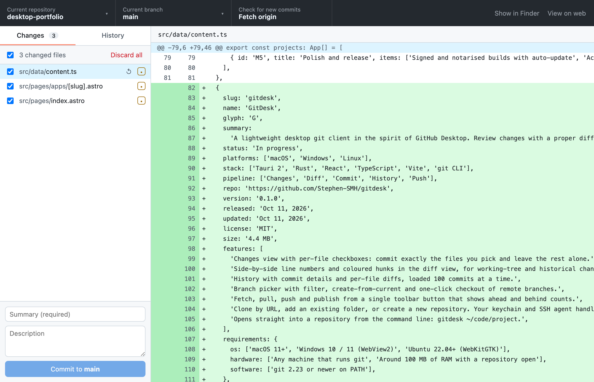
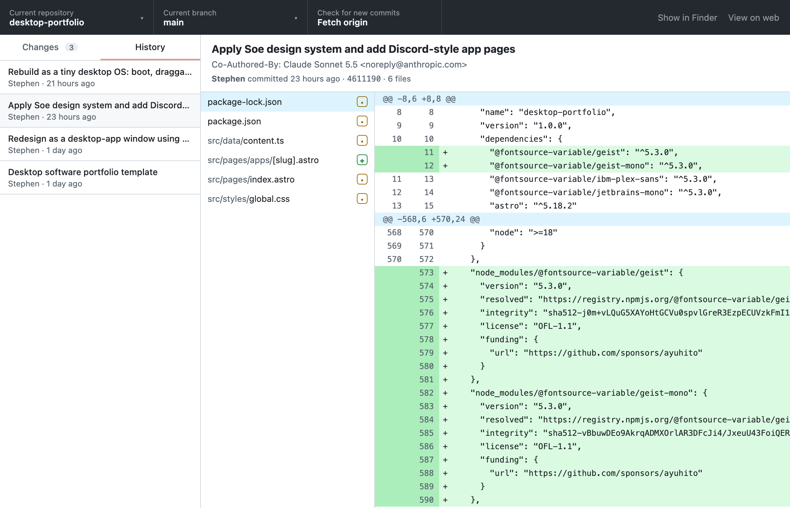
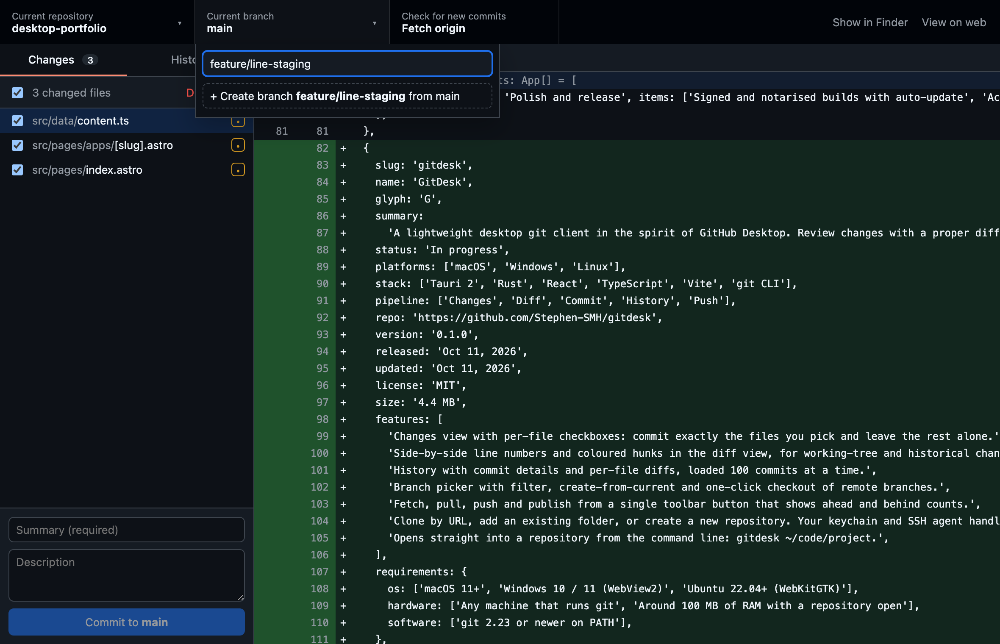

# GitDesk

A lightweight desktop git client in the spirit of GitHub Desktop, built with **Tauri 2**, **Rust** and **React**. The app bundle is about 4.4 MB. It also runs in your browser: see [Web app](#web-app).



## Features

- **Changes**: every modified, new, deleted and renamed file, with checkboxes. A commit includes exactly the files you tick. Other staged or unstaged work is left alone.
- **Diff view**: old and new line numbers with coloured hunks, for working-tree changes and past commits.
- **Commit**: summary and description. Discard one file or all changes, with a confirmation first.
- **History**: commit list (100 at a time), commit details, and a diff for each file.
- **Branches**: filter, create from the current branch, switch, and check out remote branches with tracking.
- **Sync**: one toolbar button that fetches, pulls, pushes or publishes depending on ahead/behind state.
- **Repositories**: add a local folder (and offer `git init` if it isn't a repo yet), clone by URL, and keep a recent list.
- **Command line**: `gitdesk ~/code/project` opens straight into that repository.
- Light and dark themes that follow the system.

| History | Branches (dark) |
| --- | --- |
|  |  |

## Web app

The same UI also runs in a browser tab. `gitdesk-web` is a small local server (2.3 MB, with the UI built in) that uses the desktop app's git layer, so it works on the real repositories on your machine.

```sh
npm install
npm run web                       # builds everything, serves http://127.0.0.1:4820 and opens it
npm run web -- ~/code/project     # opens straight into that repository
```

To get a standalone binary: `npm run build && cargo install --path src-web`, then run `gitdesk-web [folder] [--port N] [--no-open]`.

Everything works the same as on the desktop, with two small differences. Adding or cloning a repository uses a folder browser inside the page instead of the system dialog, and confirmations use the browser's dialog. Recent repositories are saved per browser and per port.

**Security:** the server listens on 127.0.0.1 only. Any website you visit can send requests to localhost, so the server answers only its own page. A request must be addressed to its own host and port, which defeats DNS rebinding, and requests from any other origin are refused. There is no login: any program running as you can use it, just as it could run `git` itself.

## The ChayYar family

GitDesk is the desktop client in a family of tools built around [ChayYarHub](https://github.com/Stephen-SMH/chayyarhub) (ခြေရာ, "footprints"), a self-hosted git hub. They relate the way GitHub Desktop relates to GitHub.

| Product | Like | What it does | Status |
| --- | --- | --- | --- |
| **ChayYarHub** | GitHub | Hosts repositories: code, history, issues, pull requests, accounts | v0.1, in progress |
| **GitDesk** (this repository) | GitHub Desktop | Desktop and browser client: changes, commits, history, branches, sync | v0.1, desktop and web |
| **SitMal** (စစ်မယ်, "will check") | GitHub Actions | Runs a repository's tests on every push and marks commits ✓ or ✗ | Planned |
| **PyaMal** (ပြမယ်, "will show") | GitHub Pages | Publishes a repository's website at its own address | Planned |
| **KuMal** (ကူမယ်, "will help") | Copilot | Suggests commit messages and reviews pull requests, using Claude | Planned |
| **`chayyar` CLI** | GitHub CLI | Pull requests and issues from the terminal | Planned |
| **ChayYarHub Mobile** | GitHub Mobile | Notifications and pull request review on your phone | Planned |

The names of planned products are working names. GitDesk already works with ChayYarHub as it does with any git server: clone with the repository's URL, then fetch, pull and push. For a push, git asks your credential helper for your ChayYarHub username and password.

## How it works

```
React UI ─┬─ invoke ─────▶ Tauri commands (src-tauri/src/lib.rs) ─┐
          │                                                       ├─▶ git layer (src-tauri/src/git.rs) ──▶ system `git`
          └─ POST /api ──▶ gitdesk-web (src-web/src/main.rs) ─────┘
                   both run git on a blocking thread, so the UI never freezes
```

GitDesk drives your installed `git` binary, the same way GitHub Desktop does. Both front ends call the same git layer with the same commands and arguments; `src/api.ts` picks Tauri or HTTP at runtime. Your config, hooks, credential helper (Keychain, Git Credential Manager) and SSH agent all work unchanged. `GIT_TERMINAL_PROMPT=0` makes auth failures show up as errors instead of hanging on a hidden prompt.

The git layer has integration tests that run against real temporary repositories. They cover selective commits, diffs, discard, branches, and cloning with ahead/behind tracking.

## Develop

Requirements: Node 20+, Rust (stable), git 2.23+, plus the [Tauri prerequisites](https://tauri.app/start/prerequisites/) for your OS.

```sh
npm install
npm run tauri dev               # run the app
cd src-tauri && cargo test      # git layer tests
npm run tauri build             # release bundle

npm run web:server              # web app: debug server on :4820
npm run dev                     # in a second terminal, then open http://localhost:1420 (/api is proxied)
cd src-web && cargo test        # server tests, plus the git layer tests again
```

> **macOS note:** if linking fails with `tapi error: malformed file … unknown architecture`, your Command Line Tools ship an SDK newer than their linker. Point at the older SDK: `export SDKROOT=$(xcrun --show-sdk-path --sdk macosx26.5)` (or the matching path under `/Library/Developer/CommandLineTools/SDKs/`).

## Roadmap

- Stage individual hunks and lines, stash, amend
- Merge, conflict resolution, cherry-pick and revert
- Sign-in to ChayYarHub and GitHub, with the pull request list and creation
- Signed and notarised builds with auto-update

## License

MIT © Soe Moe Htet (Stephen)
